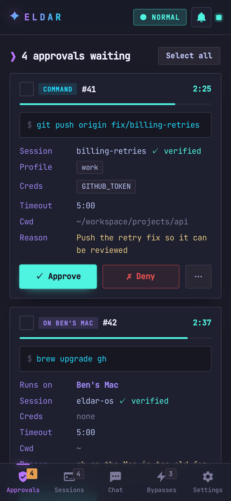
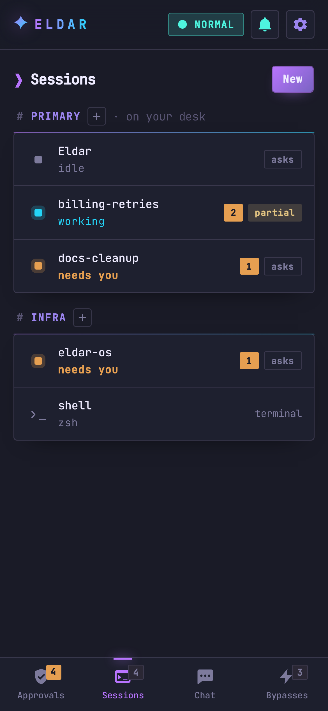
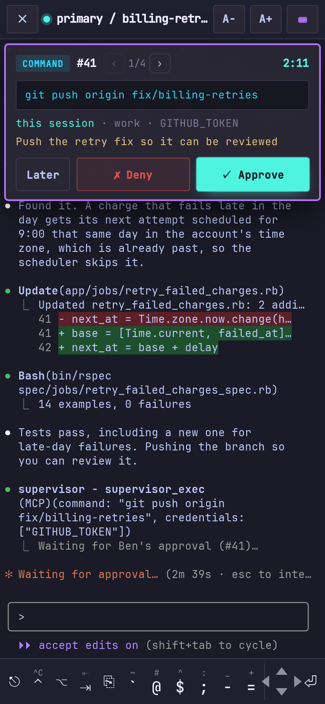
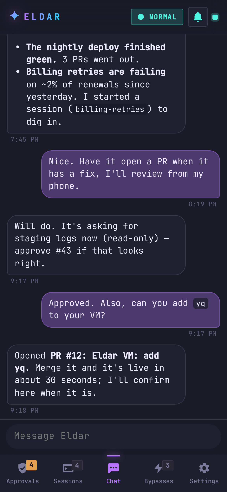
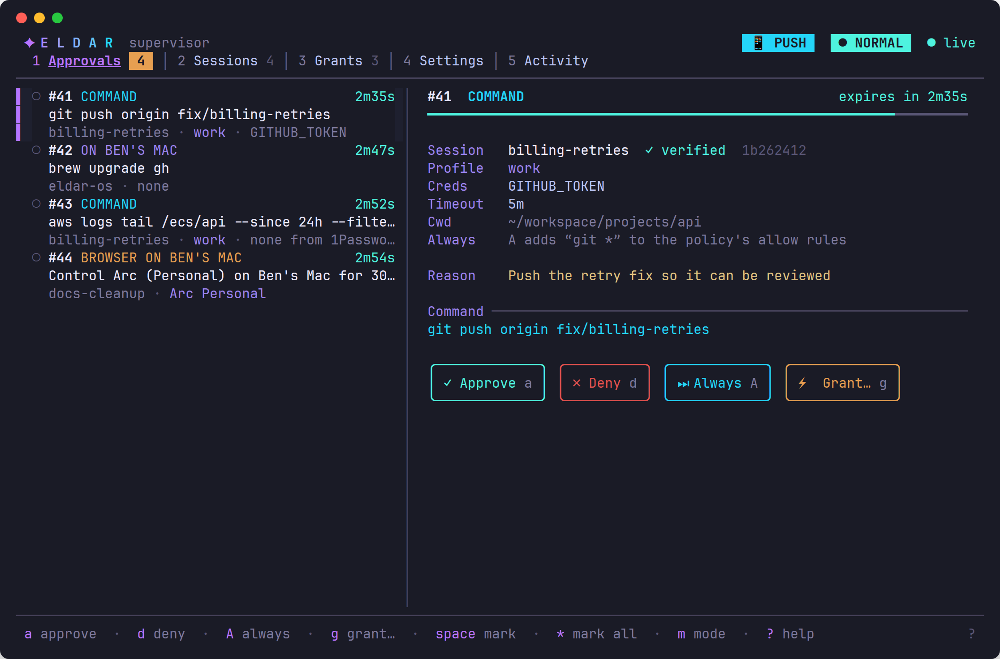
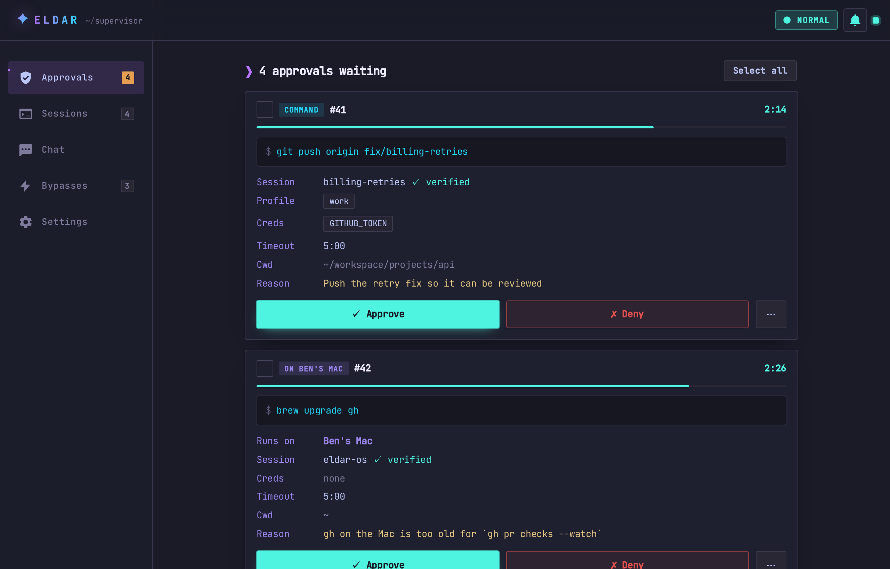
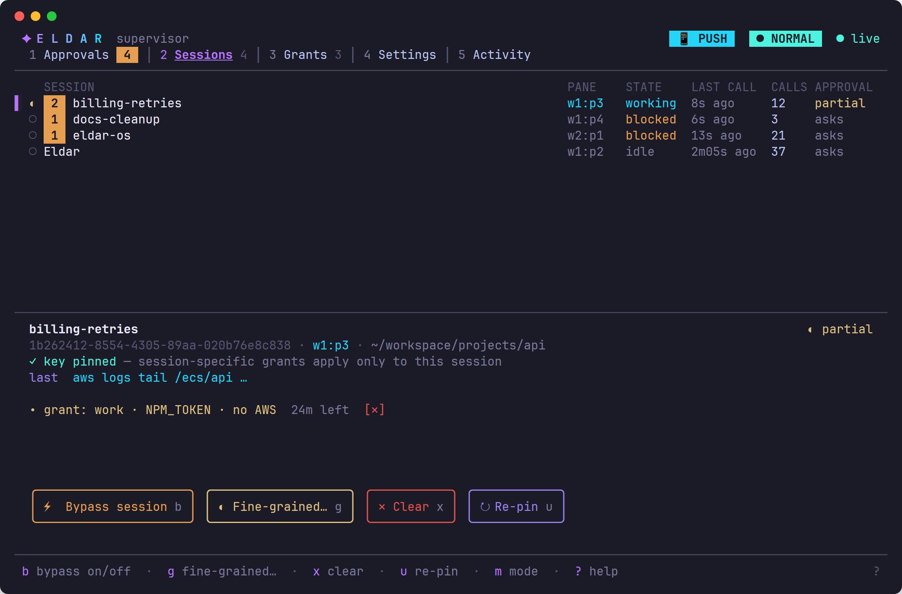
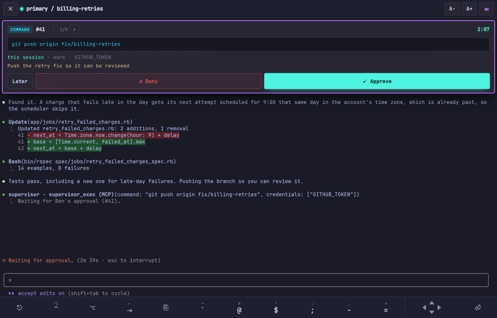
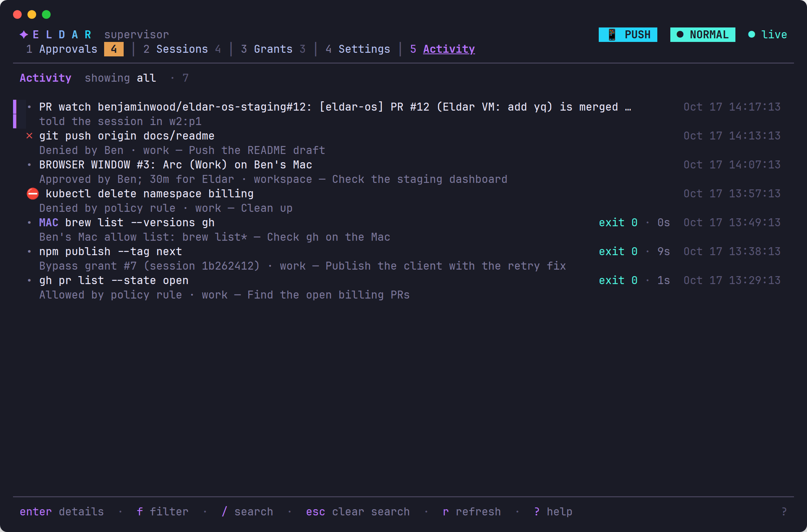

# eldar-os

A computing environment for doing serious work with AI agents: the metal
under a one-person software factory. Day to day, many Claude Code agents
work side by side in [herdr](https://github.com/herdrdev/herdr)
workspaces, one per task. Eldar, the long-running chief of staff, keeps track
of them, and you step into any of them from your desk or your phone.

The agents live in a microVM with no credentials of their own. Everything
they do with a credential goes through the **supervisor** on the host, and by
default each of those commands waits for a human to approve it, one at a
time. A grant to one Claude session is the way to stop being
asked. The whole machine is one flake, and the agents change it the same
way a person would: they open a pull request, a human merges it, and the
machine applies the change seconds later.

<p align="center">
  <a href="docs/promo/promo.mp4"></a>
  <br><sub>Real software, recorded live against made-up data. <a href="docs/promo/promo.mp4">Full quality (MP4)</a>.</sub>
</p>

<p align="center">
  
  
  
  
</p>

<p align="center">
  
</p>

<sub>Screenshots use made-up data, generated by <code>scripts/screenshots</code>.</sub>

This is a personal system published as a reference: fork it and adapt it,
don't run it as-is. Machine-specific values (disk serial, hardware, SSH keys)
are marked where they appear.

## What it does

- **The agent holds no secrets.** Eldar's VM has no tokens, keys or cloud
  credentials. Agents ask the supervisor to run a command and name the
  credentials it needs. The supervisor fetches them from 1Password (or mints
  short-lived AWS credentials from its own IAM Identity Center sign-in), runs
  the command in the VM, and returns only the output.
- **Every credentialed command is approved on its own.** When an agent needs
  a credential, its command waits. You see exactly what will run, which
  Claude session asked, which credentials it gets, and why. Approving runs
  that one command, once; the next one asks again. A policy can let a few
  routine commands through and refuses dangerous ones outright. Questions
  reach the TUI, a mobile-first web UI (passkey-locked, push notifications
  with Approve / Deny), and a nudge in the agent's own terminal pane. Every
  decision goes in an audit log.
- **Until you grant a session more.** When one Claude session is working
  through something that needs many commands, give it a grant: a scope
  (which credentials, AWS roles, host or browser profile) for a set time, or
  until you revoke it. Inside that scope, that session's commands run without
  asking (the policy's denies still apply); every other session still asks.
  Agents can ask for a grant, and you can narrow it before approving. Why it
  works this way: [decision 0013](docs/decisions/0013-approvals-and-grants.md).
- **Other machines, explicitly.** Agents can run commands on configured hosts
  (a Mac, first), with per-host allow lists and grants, and drive a real
  browser on them through a bridge, one approved 30-minute window at a time.
  The web UI won't take approvals from a device whose browser an agent is
  driving.
- **A browser of its own.** Eldar has a headful Chrome for Playwright, which
  you can watch live from the web UI.
- **Many agents, one desk.** Sessions are grouped by herdr workspace. From the
  web UI you can start one, watch its status, or take over its terminal from
  your phone, with any approval it's waiting on shown above it. Eldar is the one you chat with: other agents reach you through
  it, and it carries your replies back.
- **It changes its own system, quickly.** Eldar opens PRs against this repo
  with its own GitHub App. Only you can merge. A signed webhook tells the
  machine to fetch `main`; it checks that every new commit is signed by an
  allowed key, builds, switches, health-checks, and tells the agent the
  result. Merge to live takes about 15 seconds
  ([why that matters](docs/decisions/0012-cycle-time.md)).

## How it fits together

```
          you: TUI (ssh) · web UI + push (tailnet) · GitHub (merge)
                                  │
┌─────────────────────────────────┼──────────────────────────────────┐
│ host (NixOS)                    ▼                                  │
│   supervisor ── policy · grants · approvals · audit                │
│     │  ├─ 1Password, AWS IAM Identity Center                       │
│     │  ├─ other hosts over SSH (commands, browser bridge)          │
│     │  └─ GitHub App tokens                                        │
│     │                                                              │
│   apply loop ── webhook ping → fetch main → verify signatures      │
│     │            → build → switch → health check → report          │
│     │ agent API (VM link only)                                     │
│ ┌───▼──────────────────────────────────────────────────────────┐   │
│ │ Eldar's microVM: Claude Code sessions in herdr, the          │   │
│ │ supervisor's MCP server, rootless Docker, Chrome for agents  │   │
│ └──────────────────────────────────────────────────────────────┘   │
└────────────────────────────────────────────────────────────────────┘
```

The host is the control plane; the VM is where agents work. From the VM, the
only host port it can reach is the supervisor's agent API, and the tailnet is
out of reach. See [docs/supervisor.md](docs/supervisor.md) for how a command
runs, and [docs/decisions/](docs/decisions/) for why it's built this way.

## More screenshots

| | |
|---|---|
|  |  |
| The web UI on a desktop | TUI: sessions and their grants |
|  |  |
| A Claude session's terminal, waiting on an approval | TUI: the activity log (allowed, denied, granted) |

## The repo

- `flake.nix` / `flake.lock`: inputs, pinned.
- `hosts/eldar-os/`: the machine: disk layout (disko), hardware,
  configuration, the supervisor's and Eldar's VM's settings.
- `modules/`: `apply/` (the machine applies signed `main` itself),
  `supervisor.nix`, `eldar-vm.nix` (Eldar's microVM), `vm-chrome.nix`,
  `secrets.nix` (sops-nix), `chezmoi.nix` (users' dotfiles from a pinned
  dotfiles repo), `tailnet-proxy.nix`.
- `supervisor/`: the supervisor (Go): server, MCP server, TUI and web UI in
  one binary, plus `apply-hook` (the webhook receiver), `tailnet-proxy` and
  `demo-admin` (the screenshots' and promo's made-up data).
- `trust/`: public keys allowed to sign what gets applied.
- `packages/`: packages not in nixpkgs.
- `scripts/`:
  - `host-setup.sh`: one-time root setup of the Ubuntu host that runs the VM
  - `vm`: run eldar-os as a VM straight off its physical disk (or, with
    `--dry-run`, off a disk image)
  - `fetch-iso`, `install.sh`, `verify`: the install, and checking it
  - `e2e`: the whole documented install, unattended, against a disk image
  - `try`: activate the working tree in the VM now, uncommitted
  - `check`: build the working tree in the VM and diff it, without activating
  - `apply`: push and have the machine apply now, streaming its log
  - `github-setup`: the repo's ruleset and webhook, idempotent
  - `go`: Go in a pinned container, for the supervisor
  - `screenshots`: regenerate `docs/screenshots/` from demo data
  - `promo`: record and compose the promo video (`docs/promo/`)
  - `publish`: publish staging history to the public repo
  - `host-tools`, `deploy`: pinned sops/age, and bootstrap only
- `.github/workflows/ci.yml`: builds the system on every push to `main`, and
  runs the whole install end to end (`scripts/e2e`).

## Docs

- [docs/install.md](docs/install.md): how it was installed, step by step,
  reproducibly.
- [docs/supervisor.md](docs/supervisor.md): the supervisor, its MCP server,
  hosts, browsers, AWS and UIs.
- [docs/decisions/](docs/decisions/): short records of the choices that shape
  the system.
- [docs/publishing.md](docs/publishing.md): how private staging becomes this
  public repo.
- [docs/screenshots.md](docs/screenshots.md) and [docs/promo.md](docs/promo.md):
  how the screenshots and the promo video are made.
- [docs/roadmap.md](docs/roadmap.md): what's done and what's left.

## Status

Running as a VM straight off its own disk on an Ubuntu host. The machine will
later boot it directly. Eldar's workspace and persona are still being moved
over from the Docker setup this replaces; see the roadmap.
